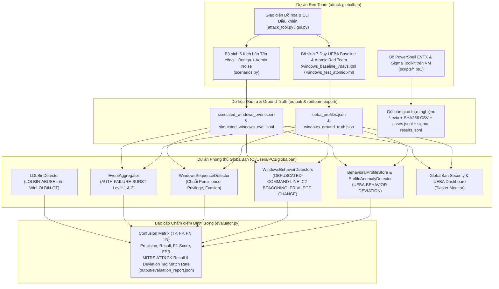

# TỔNG QUAN DỰ ÁN RED TEAM (`attack-globalban`) — CHỨC NĂNG, TÁC DỤNG & KIẾN TRÚC

Tài liệu này trình bày toàn diện về dự án **Red Team (`attack-globalban`)**: công cụ này **làm được những gì**, **có tác dụng và ý nghĩa gì** đối với hệ thống phòng thủ **GlobalBan**, và **cấu trúc các tài liệu hướng dẫn** trong thư mục `word/`.

---

## 1. Mục lục bộ tài liệu trong thư mục `word/`

Để dễ theo dõi và sử dụng khi báo cáo đồ án / thuyết trình, toàn bộ nội dung được chia thành 4 file chuyên biệt:

1. **[00_TONG_QUAN_VA_Y_NGHIA_RED_TEAM.md](file:///c:/Users/PC1/attack-globalban/word/00_TONG_QUAN_VA_Y_NGHIA_RED_TEAM.md)** *(File hiện tại)*: Tổng quan Red Team làm được gì, tại sao cần có nó, tác dụng thực tế và kiến trúc kết nối với GlobalBan.
2. **[01_CHI_TIET_8_KICH_BAN_TAN_CONG_VA_UEBA.md](file:///c:/Users/PC1/attack-globalban/word/01_CHI_TIET_8_KICH_BAN_TAN_CONG_VA_UEBA.md)**: Phân tích chuyên sâu 6 kịch bản tấn công chuỗi sự kiện Windows, kịch bản thứ 7 (UEBA học 7 ngày thói quen & phát hiện Atomic Red Team), kịch bản thứ 8 (WinLOLBIN-GT) và cơ chế kiểm thử chống báo động giả (False Positive).
3. **[02_HUONG_DAN_SU_DUNG_CONG_CU_VA_GUI.md](file:///c:/Users/PC1/attack-globalban/word/02_HUONG_DAN_SU_DUNG_CONG_CU_VA_GUI.md)**: Hướng dẫn chi tiết cách chạy công cụ qua Giao diện Đồ họa (GUI), Menu tương tác (Interactive CLI), dòng lệnh tự động, và cách đọc hiểu báo cáo chấm điểm.
4. **[03_QUY_TRINH_THU_THAP_EVTX_ATOMIC_SIGMA_THUC_TE.md](file:///c:/Users/PC1/attack-globalban/word/03_QUY_TRINH_THU_THAP_EVTX_ATOMIC_SIGMA_THUC_TE.md)**: Hướng dẫn thực hành bộ PowerShell Red Team Toolkit (`scripts/`) để thu thập log `.evtx` thật trên máy ảo Windows, chạy Atomic Red Team có phê duyệt, băm SHA256, quét luật Sigma và đóng gói bàn giao.

---

## 2. Dự án Red Team (`attack-globalban`) làm được những gì?

Dự án `attack-globalban` đóng vai trò là **Nền tảng Giả lập Tấn công (Adversary Emulation), Sinh dữ liệu Kiểm chuẩn (Benchmark Dataset Generator) và Thu thập Thực nghiệm (EVTX Collection Toolkit)** dành riêng cho hệ thống giám sát an ninh **GlobalBan**. Cụ thể, dự án thực hiện **5 nhiệm vụ cốt lõi**:

### (1) Giả lập tự động các chiến dịch tấn công Windows đa bước (Multi-step Attack Campaigns)
- Thay vì chỉ tạo các sự kiện rời rạc, công cụ sinh ra **các chuỗi sự kiện tấn công có trình tự thời gian chặt chẽ** theo chuẩn schema của **Windows Event Viewer XML** (`Security`, `Sysmon`, `PowerShell`, `Service Control Manager`).
- Bao phủ **6 nhóm chiến thuật tấn công phổ biến nhất trên Windows**:
  1. **Brute Force & Password Spraying** (`EventID 4625, 4771, 4776`)
  2. **Thực thi lệnh mã hóa / làm rối PowerShell Obfuscation** (`EventID 4688, 4104`)
  3. **Xâm nhập & Cắm chốt Persistence qua Scheduled Task / Service** (`4624 -> 4688 -> 4698 / 7045`)
  4. **Leo thang đặc quyền Privilege Escalation** (`4720 -> 4728/4732/4756 -> 4704`)
  5. **Xóa dấu vết & Vô hiệu hóa giám sát Defense Evasion** (`7045/4688 -> 1102 / 4719`)
  6. **Kết nối máy chủ điều khiển định kỳ C2 Beaconing** (`EventID 5156` chiều ra tới IP Public với chu kỳ cố định)

### (2) Xây dựng dữ liệu học thói quen 7 ngày (UEBA Baseline) & Kiểm thử lệch chuẩn Atomic Red Team
- Sinh bộ log **7 ngày hoạt động bình thường liên tiếp** (`output/windows_baseline_7days.xml` gồm **1,078 sự kiện**) của 3 nhân sự điển hình trong doanh nghiệp:
  - Nhân viên văn phòng `nguyen.an` trên máy `PC-01` (chỉ dùng Word, Excel, Chrome trong giờ hành chính 08:00–17:00).
  - Nhân viên kế toán `tran.binh` trên máy `PC-02` (chỉ dùng Excel, Word, Edge, Outlook).
  - Quản trị viên `admin.it` trên máy chủ `SRV-FILE01` (quản trị từ 09:00–16:00).
- Huấn luyện bộ nhớ hồ sơ hành vi `BehavioralProfileStore` của GlobalBan và xuất ra file `output/ueba_profiles.json`.
- Sinh bộ kiểm thử **Atomic Red Team kết hợp hành vi bình thường** (`output/windows_test_atomic.xml` và nhãn chuẩn `output/windows_ground_truth.json`), mô phỏng:
  - Kẻ tấn công chiếm tài khoản `nguyen.an` đăng nhập lúc **02:00 sáng** trên `PC-01`, bật `powershell.exe`, chạy lệnh dò tìm `whoami /all`, tải mã độc qua `Invoke-WebRequest` và kết nối C2 ra IP lạ `203.0.113.99:8443`.
  - Di chuyển ngang (*Lateral Movement*) dùng tài khoản `nguyen.an` đăng nhập vào máy chủ `SRV-FILE01` trong giờ làm việc (máy lạ đối với user và user lạ đối với server).
  - Mở PowerShell mã hóa Base64 từ tiến trình cha Microsoft Word (`WINWORD.EXE`) và tạo Scheduled Task cắm chốt trên `PC-02`.

### (3) Đánh giá phát hiện Lạm dụng công cụ có sẵn của Windows (WinLOLBIN-GT)
- Kết nối và chấm điểm bộ phát hiện `LOLBinDetector` (`LOLBIN-ABUSE`) của GlobalBan trên **1,000 mẫu dữ liệu chuẩn WinLOLBIN-GT** (500 mẫu lệnh quản trị bình thường + 500 mẫu lạm dụng `certutil`, `rundll32`, `regsvr32`, `mshta`, `wmic`, `bitsadmin`, ...).

### (4) Kiểm định khả năng chống Báo động giả (False-Positive Resilience)
- Sinh hàng trăm log hoạt động bình thường (*Benign*) và đặc biệt là **Nhiễu Quản trị viên hợp lệ (*Ambiguous Admin Noise*)** — ví dụ: Admin chạy `whoami /groups`, `certutil -store my`, `schtasks /query`, hoặc người dùng gõ sai mật khẩu 1 lần duy nhất.
- Giúp chứng minh GlobalBan **không khóa nhầm (False Positive = 0)** người dùng hợp lệ và quản trị viên hệ thống.

### (5) Cung cấp bộ Toolkit PowerShell thu thập EVTX thực tế & Quét Sigma trên máy ảo Windows (`scripts/`)
- Cung cấp quy trình 8 bước tự động hóa bằng PowerShell: kiểm tra môi trường (`preflight.ps1`), xuất log `.evtx` có lọc khung thời gian + băm `SHA256` (`collect_windows_logs.ps1`), chạy kỹ thuật Atomic Red Team có kiểm soát phê duyệt (`run_approved_atomic.ps1`), quét luật Sigma trực tiếp trên file `.evtx` (`run_sigma_on_evtx.ps1`), và đóng gói bàn giao chuẩn Pháp chứng số (`validate_handoff.ps1`).

---

## 3. Dự án Red Team này có tác dụng gì? (Giá trị thực tiễn & Học thuật)

Trong một đồ án hoặc hệ thống An toàn thông tin, nếu chỉ xây dựng mỗi phần mềm phòng thủ (**Blue Team - GlobalBan**) thì sẽ gặp 4 vấn đề lớn mà dự án **Red Team (`attack-globalban`)** giải quyết triệt để:

| Vấn đề khi chỉ có hệ thống phòng thủ | Tác dụng giải quyết của `attack-globalban` (Red Team) |
| :--- | :--- |
| **1. Không có dữ liệu tấn công thực tế để demo & kiểm thử** | Tự động sinh hàng nghìn sự kiện tấn công + bình thường chuẩn định dạng Windows XML chỉ trong vài giây, có thể đẩy trực tiếp vào CLI hoặc mở lên GlobalBan Dashboard để trình diễn trực quan. |
| **2. Không chứng minh được độ chính xác toán học (Precision, Recall, F1)** | Mỗi sự kiện sinh ra đều đi kèm nhãn Ground Truth chính xác (`is_malicious`, `expected_signal`, `expected_rule_ids`, `mitre_technique_id`). Nhờ đó tính toán tự động Ma trận nhầm lẫn (**TP, FP, FN, TN**) và chứng minh định lượng **Precision = 100%, Recall = 100%, F1 = 100%, FPR = 0%**. |
| **3. Không kiểm chứng được tính năng học máy / hành vi (UEBA)** | Để demo UEBA trên thực tế cần chờ 7 ngày thu thập log. Công cụ này tái tạo đầy đủ 7 ngày log thói quen văn phòng chuẩn xác (1,078 sự kiện) để GlobalBan học ngay lập tức và bắt chính xác các hành vi lệch chuẩn lúc 2 giờ sáng. |
| **4. Rủi ro mất an toàn khi chạy mã độc thật trên máy** | Cho phép kiểm thử an toàn 100% thông qua bộ sinh giả lập hoặc chạy Atomic Red Team có khóa phê duyệt (`-Approved`), tự động dọn dẹp (`Cleanup`) và xuất gói bằng chứng `.evtx` + `SHA256` nguyên vẹn. |

---

## 4. Sơ đồ Kiến trúc phối hợp giữa `attack-globalban` (Red Team) và `globalban` (Blue Team)

